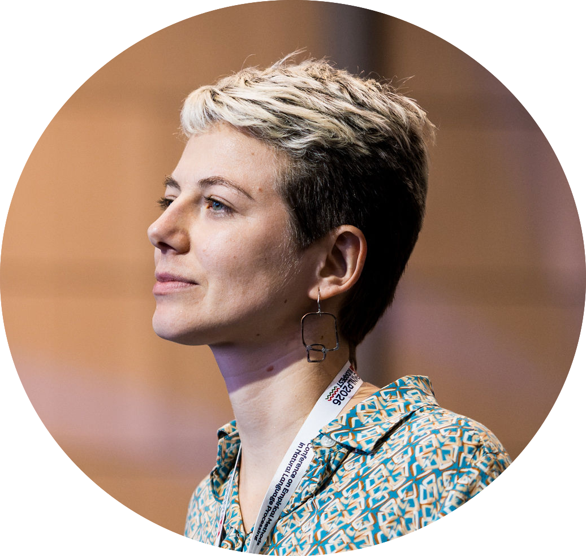

## About Me

I'm a Postdoctoral Research Fellow at the [MilaNLP](https://milanlproc.github.io) group at [Bocconi University](https://www.bocconi.it/) in Milan, Italy. My research is generally about how language models behave as information intermediaries and how to embed democratic values in AI systems. More specifically, I investigate how political biases manifest in downstream tasks, and how they are encoded during the several training phases of LLMs and distributed in the training data. Lately, I'm also interested in evaluating LLMs for reliability, diversity, and safety in the context of information seeking.

Besides models themselves, I am also very interested in text analysis. I am co-leading the project [MULTIVIEW](https://www.ims.uni-stuttgart.de/en/research/projects/multiview/) where we investigate methods for capturing perspectives in texts, how users perceive framing, and how current framing detection methods generalize across topics.

In my free time, I like to bike 🚴 and free-dive 🤿.

## Announcements

**📢 [Call for Papers now open!](https://sites.google.com/view/multidems/home)** MultiDems - Multidisciplinary Workshop NLP for Democracies, co-located with EACL 2027, Athens, Greece.

## Selected Papers

* [What Is The Political Content in LLMs' Pre-and Post-Training Data?](https://arxiv.org/pdf/2509.22367){: .pub-title}
  **Tanise Ceron**, Dmitry Nikolaev, Dominik Stammbach, Debora Nozza
  _Findings of EACL_ (2027), to appear

* [WildSEEK: Evaluating Language Models for Information-Seeking](https://aclanthology.org/2026.emnlp-main.763/){: .pub-title}
  **Tanise Ceron**, Joachim Baumann, Elisa Bassignana, Berat Cabuk, Dirk Hovy, Debora Nozza
  _EMNLP_ (2026)

* [Structuring the Space of Perspectives](https://arxiv.org/pdf/2608.12113){: .pub-title}
  Agnese Daffara, Sebastian Padó, **Tanise Ceron**
  _TACL_ (2026), to appear

* [Beyond prompt brittleness: Evaluating the reliability and consistency of political worldviews in LLMs](https://direct.mit.edu/tacl/article/doi/10.1162/tacl_a_00710/125176/Beyond-Prompt-Brittleness-Evaluating-the){: .pub-title}
  **Tanise Ceron**, Neele Falk, Ana Baric, Dmitry Nikolaev, Sebastian Padó
  _TACL_ (2024)

→ [full list of publications](/publications/)

## Resources

**📝 [Practical tips on how to evaluate LLM output with LLM-as-judges](https://docs.google.com/document/d/1xpf-7M0vQP95vRpKjES7JxBMAP66_DQ8CV_-pqFK3U8/edit?usp=sharing)**

A hands-on guide on how to run evaluation of LLM outputs reliably.

**Datasets**

* **[WildSEEK](https://huggingface.co/datasets/tceron/wildseek)**: information-seeking queries annotated for high-risk sensitive topics and open-endedness.
* **[StancePol](https://huggingface.co/datasets/tceron/stancepol)**: political stances in LLM training documents.
* **[ProbVAA](https://huggingface.co/datasets/tceron/probvaa)**: questions compiled from 7 voting advice applications from European countries. Further annotations on policy issues are available [here](https://github.com/tceron/eval_political_worldviews/blob/main/data/human_annotations/annotations_spiderweb_gold.csv).
* **[FrameNews-PT](https://github.com/tceron/FrameNews-PT/blob/main/data/frames_recsys_test.csv)**: news articles from Brazil annotated with media frame labels from 2 annotators.

## Contact

<ul class="contact-links">
  <li>📧 tanise[dot]ceron[at]unibocconi.it</li>
  <li>🎓 <a href="{{ site.author.googlescholar }}">Google Scholar</a> · <a href="{{ site.author.orcid }}">ORCID</a></li>
  <li>💻 <a href="https://github.com/{{ site.author.github }}">GitHub</a></li>
  <li>🦋 <a href="https://bsky.app/profile/{{ site.author.bluesky }}">Bluesky</a> · <a href="https://www.linkedin.com/in/{{ site.author.linkedin }}">LinkedIn</a></li>
</ul>
